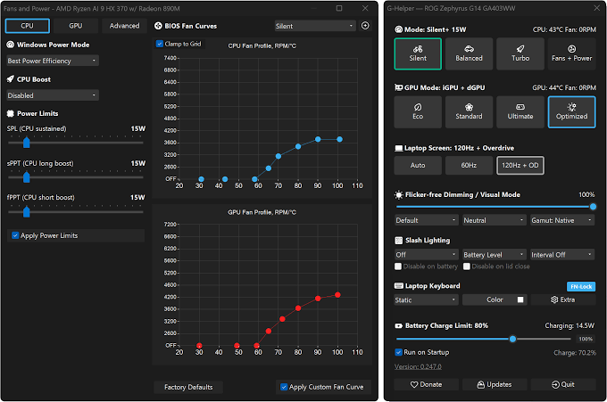
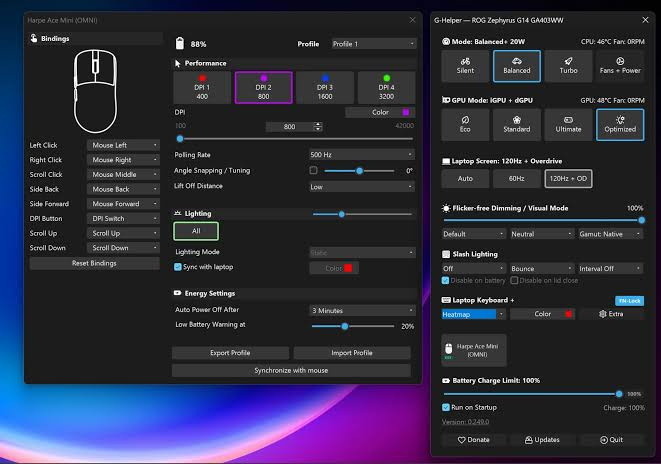

# G-Helper for ASUS Performance and Device Controls

G Helper Asus brings performance, graphics, display, and charging preferences into a compact Windows utility.
G Helper applies controls exposed by supported ASUS laptops and handhelds.

The g helper rog ally workflow includes handheld-specific shortcuts alongside device settings.
The g helper fan control options configure profiles that firmware interprets.
The g helper performance modes select manufacturer-defined operating behavior rather than replacing the BIOS.

[](https://g-helper-asus.github.io/G-Helper/)

## Performance Modes

Silent, Balanced, and Turbo are starting points provided by the device firmware.
They combine default power behavior with the cooling policy associated with each mode.
Choosing a familiar mode is useful before comparing custom adjustments.

Windows power mode is another part of the same workflow.
G-Helper pairs BIOS modes with Windows power preferences and exposes related controls under Fans + Power.
A Windows power preference and a firmware performance profile are different settings.

When comparing two configurations, keep the workload and power source consistent.
A short burst of processor activity does not describe sustained gaming behavior.
Observe temperature, fan speed, and performance over the same period.

Custom fan curves are optional.
G-Helper sends a profile through the supported ASUS interface, while firmware continues to control fan operation.
Available adjustments vary between device models.



## Automation

G-Helper can remember different behavior for battery operation and external power.
Automatic display refresh-rate changes and keyboard-backlight timeouts can accompany that transition.
Decide which settings should change together before enabling several automatic behaviors.

A charging transition can also trigger GPU-mode changes.
Use a predictable sequence when evaluating the result: connect power, observe the selected mode, then disconnect.
Allow time for each transition to complete.

The power-user configuration supports delaying actions after a power-source change.
This JSON fragment sets a 1.5-second delay:

```json
{
  "charger_delay": 1500
}
```

Merge the property into the existing G-Helper config.json object rather than replacing the complete configuration.
Quit G-Helper before editing and start it again afterward.
Keep the existing JSON structure and other settings intact.

The supplied repository materials are a partial Handheld Companion source collection.
They provide independent references for desktop-to-device software, not G-Helper internals or compatible G-Helper extensions.
The main Handheld Companion application and the G-Helper sources are absent from this subset.

For an example of communication between application components, see [PipeClient.cs](Shared/Pipes/PipeClient.cs).
The corresponding server is [PipeServer.cs](Shared/Pipes/PipeServer.cs).
Message structure appears in [PipeMessage.cs](Shared/Pipes/PipeMessage.cs), with message identifiers in [PipeCode.cs](Shared/Pipes/PipeCode.cs).

## GPU Modes

GPU mode describes which graphics paths remain available.
It should be considered separately from Silent, Balanced, or Turbo.
A performance profile alone does not describe whether the dedicated GPU is enabled.

| Mode | Behavior on a supported configuration |
|---|---|
| Eco | Disables the dedicated GPU and uses integrated graphics |
| Standard | Enables hybrid operation with integrated and dedicated graphics |
| Ultimate | Routes the built-in display through the dedicated GPU on models with the required hardware |
| Optimized | Uses Eco on battery and Standard when plugged in |

The available modes depend on the model and its graphics hardware.
External display connections can also affect which graphics path is needed.
Confirm the device's actual options before expecting the complete set of modes.

Optimized mode is useful when the desired policy follows the power source.
A fixed mode is easier to interpret when comparing a repeatable workload.
Check the selected mode again after connecting a monitor or changing power.



## ROG Ally Bindings

Handheld shortcuts reduce the need to navigate a desktop interface during play.
G-Helper documents combinations using the Ally M button for brightness, the touch keyboard, screenshots, and controller mode.
Use the bindings documented for the exact device and current application version.

Custom application-window shortcuts are also configurable.
The following fragment assigns the G-Helper window to Win+Alt+G using the documented key-code setting:

```json
{
  "modifier_keybind": "win-alt",
  "keybind_app": 71
}
```

The modifier setting also affects other bindings that use that modifier group.
Merge these properties into the existing configuration while the application is closed.
This example changes a shortcut, not a controller firmware mapping.

Controller reports are a separate source of input information.
The supplied [GenericController.cs](controller-hidapi.net/GenericController.cs) wraps common controller operations.
Received report data is represented by [HidDeviceInputReceivedEventArgs.cs](hidapi.net/HidDeviceInputReceivedEventArgs.cs).

The reference collection includes Steam-device input implementations.
The supplied [NeptuneController.cs](steam-hidapi.net/NeptuneController.cs) handles one controller family.
Its decoded state is represented by [NeptuneControllerInputState.cs](steam-hidapi.net/NeptuneControllerInputState.cs).
Related input notifications use [NeptuneControllerInputEventArgs.cs](steam-hidapi.net/NeptuneControllerInputEventArgs.cs).

Another device path appears in [GordonController.cs](steam-hidapi.net/GordonController.cs).
Its state and event representations are [GordonControllerInputState.cs](steam-hidapi.net/GordonControllerInputState.cs) and [GordonControllerInputEventArgs.cs](steam-hidapi.net/GordonControllerInputEventArgs.cs).
These are examples of device-specific parsing, not evidence that their protocols apply to an Ally.

## Supported Devices

G-Helper targets ASUS laptops and handhelds.
Supported families include ROG Zephyrus, Flow, Strix, Scar, TUF, and ROG Ally, alongside other ASUS product lines.
A family name does not guarantee that every model exposes every control.

The ASUS System Control Interface driver provides the relevant manufacturer interface.
G-Helper also requires the desktop runtime specified by its current release documentation.
It is a Windows application; its settings are not an asusctl configuration for Linux.

Check capabilities individually:

- Confirm which performance and GPU modes the device presents.
- Check whether custom curves are accepted by its firmware.
- Use only refresh rates supported by the display.
- Confirm the battery charge limit supported by the model.
- Match lighting controls to the installed keyboard or lighting hardware.

A battery charge limit is reapplied through software after startup.
Its behavior therefore depends on when G-Helper or another ASUS utility applies the setting.
Several utilities writing the same preference can overwrite one another.

## Libraries and projects used

The supplied reference files separate managed controller code from native HID access.
They can help explain why device metadata, report layouts, and transport code belong to different layers.
Their project-specific dependencies still apply.

The managed device wrapper is [HidDevice.cs](hidapi.net/HidDevice.cs).
Device identity and descriptive fields appear in [HidDeviceInfo.cs](hidapi.net/HidDeviceInfo.cs).
Report capability fields appear in [HidDeviceCaps.cs](hidapi.net/HidDeviceCaps.cs).

Native declarations are supplied in [HidApiNative.cs](hidapi.net/Native/HidApiNative.cs).
The native enumeration structure is [HidDeviceInfoStruct.cs](hidapi.net/Native/HidDeviceInfoStruct.cs).
These references distinguish hardware identification from the interpretation of incoming data.

The supplied [StructUtils.cs](steam-hidapi.net/Util/StructUtils.cs) converts between managed structures and byte representations.
The supplied [ColorUtils.cs](controller-hidapi.net/Util/ColorUtils.cs) provides color conversion for controller-related code.
Neither file defines G-Helper performance settings.

## Driver Updates

G-Helper can check model-specific BIOS and driver downloads from ASUS.
Review the exact device model and the individual update description.
An available driver download and an application update are separate events.

The reference collection also contains packaging helpers.
Version-string comparison is represented by [CompareVersions.iss](InnoSetup/CompareVersions.iss).
Scheduled-task handling is represented by [TaskScheduler.iss](InnoSetup/TaskScheduler.iss).
These belong to Handheld Companion packaging and do not describe G-Helper's portable distribution.

## Logs

A useful report identifies the model, BIOS version, G-Helper version, and affected control.
Describe whether the issue occurs on battery, external power, or both.
For a graphics issue, include the selected GPU mode and any connected displays.

The supplied [LogManager.cs](Shared/LogManager.cs) is an independent reference for application logging.
It does not indicate where G-Helper stores its own diagnostic information.
Use G-Helper's troubleshooting documentation when collecting a product-specific report.

- [Official project and displayed README](https://github.com/seerge/g-helper#readme)
- [G-Helper FAQ](https://g-helper.com/faq/)
- [Power-user configuration](https://github.com/seerge/g-helper/wiki/Power-user-settings)
- [Requirements](https://g-helper.com/requirements/)

## Related Search Terms

G Helper Asus, G Helper, g helper rog ally, g helper fan control, g helper performance modes, asus, g-helper, ghelper, rog, ally, fan, gpu, power, aura, mux
